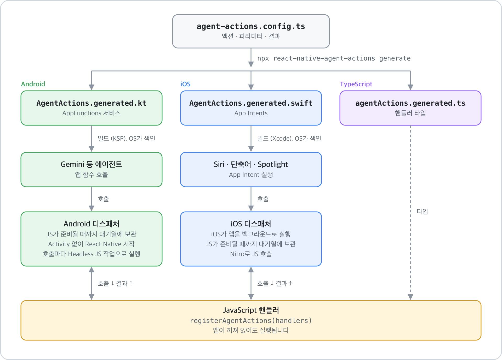
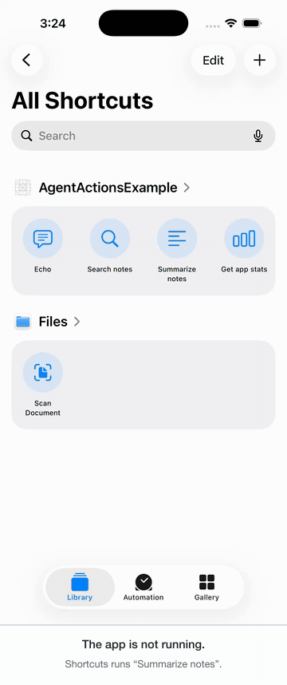
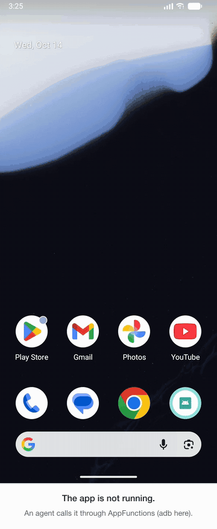

# react-native-agent-actions

[English](README.md)

AI 에이전트가 React Native 앱의 기능을 호출하게 해 주는 라이브러리입니다. 액션을 TypeScript로 한 번 선언하고 JavaScript로 구현하면 두 플랫폼에 노출됩니다.

- **Android [AppFunctions](https://developer.android.com/ai/appfunctions)**: Gemini 같은 온디바이스 에이전트가 앱 함수를 호출하는 경로입니다.
- **iOS [App Intents](https://developer.apple.com/documentation/appintents)**: Siri와 단축어, Spotlight가 쓰는 경로입니다.

<picture>
  <source srcset="docs/flow.ko.svg" type="image/svg+xml">
  
</picture>

<table>
  <tr>
    <th>iOS: 앱이 꺼진 상태에서 단축어로 액션 실행</th>
    <th>Android: 앱이 꺼진 상태에서 에이전트가 액션 호출</th>
  </tr>
  <tr>
    <td></td>
    <td></td>
  </tr>
</table>

[예제 앱](example)을 iOS 시뮬레이터와 Android 17 에뮬레이터에서 녹화했습니다. Android 호출은 `adb shell cmd app_function execute-app-function`으로 보냈습니다. 에이전트가 쓰는 시스템 API와 같은 경로입니다. 영상 원본: [iOS MP4](docs/demo-ios.mp4), [Android MP4](docs/demo-android.mp4)

> [!WARNING]
> **초기 버전입니다.** Google의 AppFunctions 라이브러리는 아직 alpha(`androidx.appfunctions` `1.0.0-alpha13`)라 버전마다 API가 바뀝니다. Gemini에서 앱 함수를 호출하는 기능도 아직 사전 참여 프로그램으로만 열려 있습니다. 호환되지 않는 변경이 생길 수 있습니다.

> [!CAUTION]
> OS가 허용한 호출자는 선언한 액션을 모두 실행할 수 있습니다. 앱이 백그라운드에 있고 사용자가 보고 있지 않을 때도 마찬가지입니다. 확인 없이 실행해도 안전한 액션만 노출하고 핸들러에서 모든 파라미터를 검증하세요.

## 요구 사항

| 항목 | 조건 |
|---|---|
| React Native | 0.87 이상, New Architecture. AppFunctions가 `compileSdk` 37과 Android Gradle Plugin 9.1을 요구하는데 React Native 0.87이 이 버전을 씁니다. |
| 네이티브 모듈 | [`react-native-nitro-modules`](https://nitro.margelo.com) 0.37 이상 |
| Android | `minSdk`와 관계없이 빌드됩니다. 에이전트는 Android 16(API 36) 이상에서 액션을 볼 수 있습니다. |
| iOS | React Native가 지원하는 배포 대상이면 빌드됩니다. 액션은 iOS 16 이상에서 동작합니다. |
| Node | `.ts` 설정 파일을 읽으려면 22.18 이상이 필요합니다. 이전 버전은 `.mjs`나 `.json`을 쓰면 됩니다. |

## 설치

```sh
npm install react-native-agent-actions react-native-nitro-modules
```

## 1. 액션 선언

앱의 `package.json` 옆에 `agent-actions.config.ts`를 만듭니다. 형식은 [영문 README](README.md#1-declare-actions)의 예시와 같습니다.

에이전트는 액션의 `description`과 파라미터 설명을 보고 언제 호출할지 판단합니다. 앱을 처음 보는 사람이 읽어도 알 수 있게 쓰세요.

## 2. 네이티브 코드 생성

```sh
npx react-native-agent-actions generate
cd ios && pod install
```

설정을 바꿀 때마다 다시 실행합니다. 생성하는 파일은 세 개입니다.

| 파일 | 내용 |
|---|---|
| `android/app/src/main/java/dev/agentactions/generated/AgentActions.generated.kt` | 액션마다 함수가 하나씩 있는 AppFunctions 진입점 서비스 |
| `ios/<App>/AgentActions.generated.swift` | 액션마다 App Intent 하나, `phrases`가 있는 액션의 App Shortcuts |
| `src/agentActions.generated.ts` | 핸들러 타입 |

처음 실행할 때는 프로젝트 설정도 함께 바꿉니다. `AndroidManifest.xml`에 서비스를, `android/build.gradle`에 KSP Gradle 플러그인을, `android/app/build.gradle`에 `apply from: .../agent-actions.gradle`을 추가합니다. Swift 파일은 Xcode 타깃에, `AgentActionsCore` pod는 Podfile에 추가합니다. 생성된 파일은 커밋하세요.

CI에서는 `npx react-native-agent-actions generate --check`로 생성 파일이 최신인지 확인할 수 있습니다.

## 3. JavaScript로 처리

`index.js`의 모듈 최상단에서 핸들러를 한 번 등록합니다. OS가 액션을 실행하려고 앱을 백그라운드로 띄우면 화면이 그려지지 않을 수 있습니다. 컴포넌트 안에서 등록한 핸들러는 그때 호출되지 않습니다.

```js
// index.js
import { AppRegistry } from 'react-native';
import { registerAgentActions } from 'react-native-agent-actions';
import { handlers } from './src/agentActionHandlers';
import App from './src/App';

registerAgentActions(handlers);

AppRegistry.registerComponent('MyApp', () => App);
```

```ts
// src/agentActionHandlers.ts
import type { AgentActionHandlers } from './agentActions.generated';

export const handlers: AgentActionHandlers = {
  searchNotes: async ({ query, limit = 5 }) => {
    const notes = await notesStore.search(query);
    return notes.slice(0, limit);
  },
};
```

객체 타입을 `AgentActionHandlers`로 지정하면 모든 액션에 핸들러가 있는지와 파라미터·결과 타입을 TypeScript가 검사합니다. 핸들러가 예외를 던지면 에이전트는 그 메시지를 받습니다.

## 스키마

**파라미터**는 `string`, `number`, `integer`, `boolean`, `string` 배열을 쓸 수 있습니다. 에이전트가 생략해도 되는 파라미터는 `optional: true`로 표시합니다.

**결과**는 위 타입과 `object`(PascalCase `name`과 `properties` 필요), 배열을 쓸 수 있습니다. 배열 안의 배열은 쓸 수 없습니다. 객체 속성은 `optional: true`로 두면 `null`이거나 빠질 수 있습니다. 돌려줄 값이 없는 액션은 `result`를 생략합니다.

플랫폼별 타입 대응과 액션 옵션(`timeoutMs`, `platforms`, `ios.phrases`, `ios.systemImageName`)은 [영문 README의 Schema 절](README.md#schema)에 표로 정리돼 있습니다.

## 호출이 JavaScript까지 가는 방식

네이티브 쪽이 호출 대기열을 둡니다. JavaScript가 핸들러를 등록하기 전에 들어온 호출은 대기열에서 기다립니다.

- **Android**: 호출 때문에 앱 프로세스가 새로 뜨면 라이브러리가 Activity 없이 React Native를 시작합니다. 번들이 `registerAgentActions`를 실행하면 대기 중인 호출을 넘깁니다. 호출마다 [Headless JS](https://reactnative.dev/docs/headless-js-android) 작업으로 실행합니다. React Native는 headless 작업이 없으면 백그라운드에서 JavaScript 타이머를 멈추기 때문입니다. 앱의 `Application`은 `ReactApplication`을 구현해야 하고 React Native 템플릿은 이미 구현돼 있습니다.
- **iOS**: 시스템이 앱을 백그라운드로 실행합니다. React Native는 평소처럼 `AppDelegate`에서 시작하고 번들이 로드되면 대기 중인 호출을 처리합니다.

에뮬레이터와 시뮬레이터에서 release 빌드로 재 보니 꺼져 있던 앱에 대한 호출이 Android는 약 0.1초, iOS는 약 0.5초 만에 돌아왔습니다. 핸들러가 `timeoutMs` 안에 답하지 않으면 호출자는 에러를 받습니다.

## 테스트

**iOS**: `phrases`가 있는 액션은 단축어 앱의 앱 이름 아래에 나타납니다. 거기서 실행하거나 Siri에게 문구로 요청하세요. 모든 액션은 단축어에 추가할 수 있는 동작으로도 나타납니다.

**Android**: Android 16 이상 기기나 에뮬레이터에서 `adb`로 색인된 함수를 보고 호출할 수 있습니다. 함수 ID는 `dev.agentactions.generated.AgentActionsServiceBase#<action>` 형식입니다.

```sh
adb shell cmd app_function list-app-functions --package your.app.id

adb shell cmd app_function execute-app-function \
  --package your.app.id \
  --function 'dev.agentactions.generated.AgentActionsServiceBase#searchNotes' \
  --parameters "'{\"query\":\"trip\"}'"
```

앱을 새로 띄워야 하는 호출을 시험하려면 먼저 `adb shell am force-stop your.app.id`를 실행하세요.

## 한계

- Android: 생성된 함수는 `AppFunctionService` 하위 클래스 안에 있습니다. 그래서 액션 이름이 `android.app.Service` 메서드 이름과 겹치면 안 됩니다.
- iOS: 앱 하나에 `AppShortcutsProvider`는 하나만 둘 수 있습니다. 앱에 이미 있다면 `phrases`를 쓰지 마세요. 단축어에서는 그대로 동작합니다.
- iOS는 객체 결과를 JSON 문자열로 돌려줍니다. App Intents가 돌려줄 수 있는 값 타입이 정해져 있기 때문입니다.
- enum, map, 날짜, 배열 안의 배열은 아직 지원하지 않습니다.
- Expo config plugin은 아직 없습니다. prebuild 프로젝트라면 `expo prebuild` 뒤에 생성기를 실행하세요.

## 라이선스

MIT
