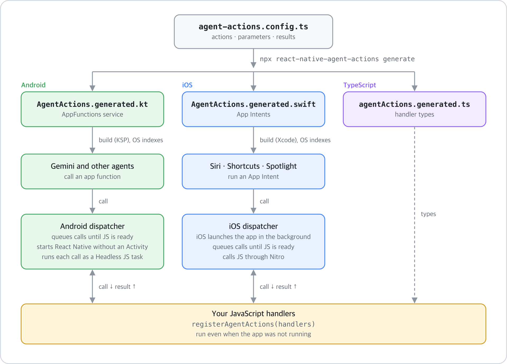

# react-native-agent-actions

[한국어](README.ko.md)

Let AI agents call into your React Native app. You declare actions once in TypeScript, implement them in JavaScript, and the library exposes them through:

- **Android [AppFunctions](https://developer.android.com/ai/appfunctions)**, which Gemini and other on-device agents use to call app functions, and
- **iOS [App Intents](https://developer.apple.com/documentation/appintents)**, which Siri, Shortcuts and Spotlight use.

<picture>
  <source srcset="docs/flow.svg" type="image/svg+xml">
  
</picture>

<table>
  <tr>
    <th>iOS: Shortcuts runs actions while the app is not running</th>
    <th>Android: an agent calls actions while the app is not running</th>
  </tr>
  <tr>
    <td></td>
    <td></td>
  </tr>
</table>

Recorded with the [example app](example) on an iOS simulator and an Android 17 emulator. On Android the calls come from `adb shell cmd app_function execute-app-function`, which goes through the same system API that agents use. MP4 versions: [iOS](docs/demo-ios.mp4), [Android](docs/demo-android.mp4).

> [!WARNING]
> **Early release.** Google's AppFunctions library is still alpha (`androidx.appfunctions` `1.0.0-alpha13`) and changes between versions, and calling app functions from Gemini is limited to an early access program. Expect breaking changes.

> [!CAUTION]
> Any caller the OS allows can run the actions you declare, including when the app is in the background and no user is looking at it. Expose actions that are safe to run without confirmation, and validate every parameter in your handler.

## Requirements

| Area | Requirement |
|---|---|
| React Native | 0.87 or later, New Architecture. AppFunctions needs `compileSdk` 37 and Android Gradle Plugin 9.1, which React Native 0.87 provides. |
| Native modules | [`react-native-nitro-modules`](https://nitro.margelo.com) 0.37 or later |
| Android | The app builds for any `minSdk`. Agents can see the actions on Android 16 (API 36) and later. |
| iOS | The app builds for any deployment target React Native supports. The actions exist on iOS 16 and later. |
| Node | 22.18 or later to load a `.ts` config. Older versions can use `.mjs` or `.json`. |

## Install

```sh
npm install react-native-agent-actions react-native-nitro-modules
```

## 1. Declare actions

Create `agent-actions.config.ts` next to your app's `package.json`:

```ts
import type { AgentActionsConfig } from 'react-native-agent-actions';

export default {
  actions: {
    searchNotes: {
      title: 'Search notes',
      description: 'Finds notes whose title or tags contain the query.',
      params: {
        query: { type: 'string', description: 'Text to look for.' },
        limit: {
          type: 'integer',
          optional: true,
          description: 'Maximum number of notes to return. Defaults to 5.',
        },
      },
      result: {
        type: 'array',
        description: 'Matching notes, best match first.',
        items: {
          type: 'object',
          name: 'Note',
          properties: {
            id: { type: 'string', description: 'Stable identifier of the note.' },
            title: { type: 'string', description: 'Title of the note.' },
            pinned: { type: 'boolean', description: 'Whether the note is pinned.' },
          },
        },
      },
      ios: {
        phrases: ['Search notes in ${applicationName}'],
        systemImageName: 'magnifyingglass',
      },
    },
  },
} satisfies AgentActionsConfig;
```

Agents decide when to call an action from its `description` and the descriptions of its parameters, so write them for a reader who has never seen your app.

## 2. Generate the native code

```sh
npx react-native-agent-actions generate
cd ios && pod install
```

Run it again whenever you change the config. It writes:

| File | Purpose |
|---|---|
| `android/app/src/main/java/dev/agentactions/generated/AgentActions.generated.kt` | AppFunctions entry point service with one function per action |
| `ios/<App>/AgentActions.generated.swift` | One App Intent per action, plus App Shortcuts for actions with `phrases` |
| `src/agentActions.generated.ts` | Types for your handlers |

The first run also wires the generated code into your project: it adds the service to `AndroidManifest.xml`, the KSP Gradle plugin to `android/build.gradle`, `apply from: .../agent-actions.gradle` to `android/app/build.gradle`, the Swift file to the Xcode target, and the `AgentActionsCore` pod to the Podfile. Commit the generated files.

Use `npx react-native-agent-actions generate --check` in CI to fail when the generated files are out of date.

## 3. Handle the actions in JavaScript

Register the handlers once, at module scope in `index.js`. The OS can start your app in the background to run an action, and then no screen is rendered, so handlers registered inside a component would never be reached.

```js
// index.js
import { AppRegistry } from 'react-native';
import { registerAgentActions } from 'react-native-agent-actions';
import { handlers } from './src/agentActionHandlers';
import App from './src/App';

registerAgentActions(handlers);

AppRegistry.registerComponent('MyApp', () => App);
```

```ts
// src/agentActionHandlers.ts
import type { AgentActionHandlers } from './agentActions.generated';

export const handlers: AgentActionHandlers = {
  searchNotes: async ({ query, limit = 5 }) => {
    const notes = await notesStore.search(query);
    return notes.slice(0, limit);
  },
};
```

Typing the object as `AgentActionHandlers` makes TypeScript require a handler for every action and check the parameters and results. If a handler throws or rejects, the agent receives the error message.

## Schema

**Parameters** can be `string`, `number`, `integer`, `boolean`, or `array` of `string`. Mark them `optional: true` when the agent may leave them out.

**Results** can be any of those types, `object` (with a PascalCase `name` and `properties`), or `array` of any of them except arrays. Object properties can be `optional: true`, which means `null` or missing. Leave `result` out for actions that return nothing.

| Config | Android (Kotlin) | iOS (App Intents) | TypeScript |
|---|---|---|---|
| `string` | `String` | `String` | `string` |
| `number` | `Double` | `Double` | `number` |
| `integer` | `Long` | `Int` | `number` |
| `boolean` | `Boolean` | `Bool` | `boolean` |
| `array` of `string` | `List<String>` | `[String]` | `string[]` |
| `array` of `number` / `integer` / `boolean` | `DoubleArray` / `LongArray` / `BooleanArray` | `[Double]` / `[Int]` / `[Bool]` | `number[]` / `boolean[]` |
| `object`, `array` of `object` | `@AppFunctionSerializable` data classes | JSON string | interfaces |

Other options per action:

| Option | Default | Meaning |
|---|---|---|
| `timeoutMs` | `10000` | How long the native side waits for your handler. iOS caps it at 25000 because the system stops App Intents after 30 seconds. |
| `platforms` | `['android', 'ios']` | Limit an action to one platform. |
| `ios.phrases` | none | App Shortcut phrases for Siri and Spotlight. Each must contain `${applicationName}`. At most 10 actions can have phrases. |
| `ios.systemImageName` | `sparkles` | SF Symbol for the App Shortcut. |

## How calls reach JavaScript

The native side keeps a queue of calls. When a call arrives before JavaScript has registered its handlers, it waits in the queue:

- **Android:** if the app process was started for the call, the library starts React Native without an Activity, the bundle runs `registerAgentActions`, and the queued call is delivered. Each call runs as a [Headless JS](https://reactnative.dev/docs/headless-js-android) task, because React Native pauses JavaScript timers in the background unless a headless task is active. Your `Application` must implement `ReactApplication`, which the React Native template does.
- **iOS:** the system launches the app in the background. React Native starts from `AppDelegate` as usual, and the queued call is handled once the bundle has loaded.

Measured on an emulator and a simulator with release builds, a call to an app that was not running returned in about 0.1 s on Android and 0.5 s on iOS. If the handler does not answer within `timeoutMs`, the caller gets an error. Errors thrown by a handler reach the caller with their message.

## Testing

**iOS:** actions with `phrases` show up in the Shortcuts app under your app's name. Run them from there, or ask Siri with the phrase. Every action also appears as an action you can add to a shortcut.

**Android:** on an Android 16 or later device or emulator, list the indexed functions and call one with `adb`. Function ids have the form `dev.agentactions.generated.AgentActionsServiceBase#<action>`.

```sh
adb shell cmd app_function list-app-functions --package your.app.id

adb shell cmd app_function execute-app-function \
  --package your.app.id \
  --function 'dev.agentactions.generated.AgentActionsServiceBase#searchNotes' \
  --parameters "'{\"query\":\"trip\"}'"
```

Run `adb shell am force-stop your.app.id` first to test a call that has to start the app.

## Limitations

- Android: action names must not clash with methods of `android.app.Service`, because the generated functions live in an `AppFunctionService` subclass.
- iOS: an app can have only one `AppShortcutsProvider`. If your app already has one, do not use `phrases`; the intents still work in Shortcuts.
- iOS returns objects as a JSON string, because App Intents can only return a fixed set of value types.
- Enums, maps, dates and nested arrays are not supported yet.
- Expo config plugin: not yet. In a prebuild project, run the generator after `expo prebuild`.

## Example app

[`example/`](example) declares a few actions in [`agent-actions.config.ts`](example/agent-actions.config.ts) and implements them in [`src/agentActionHandlers.ts`](example/src/agentActionHandlers.ts).

```sh
yarn
yarn generate
yarn example ios     # or: yarn example android
```

## License

MIT
